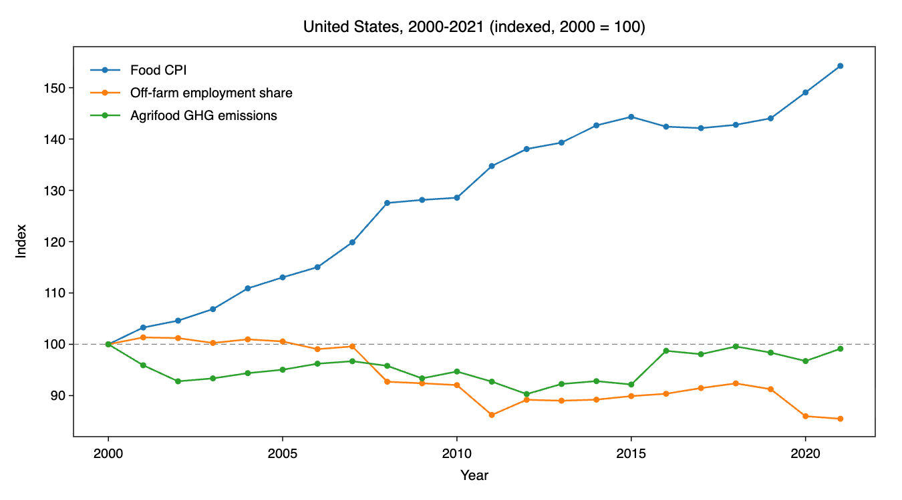

# Interim Status Report

- **Project:** Food Price Inflation, Agrifood Employment, and Agrifood GHG Emissions in the United States
- **Team:** Lauren Peng, Vanisha Janaki, Kevin Ting, Ranveer Ganna
- **Milestone:** 3 – Interim Status Report

## 1. Summary of Progress

Data for all three datasets has been acquired, cleaned and described and now there is a first version of the integrated data source created. The integration of the three cleaned data sources is based on the country (USA) and year, so the output of the integration is one record per year within 2000 to 2021 period (22 records). The post-integration quality check and exploratory analysis graph have been done as well. Now, all that is left is to build up the workflow out of the pieces: an acquisition script with SHA-256 check, cleaning scripts for all the datasets, a workflow orchestrator, and the metadata and license files.

## 2. Task Updates

### 2.1 Data acquisition — *complete (manual), automation pending*

The three datasets were acquired from the World Bank Data360 web site and committed into the repository:

| Dataset | Raw file | Source | Granularity | Coverage |
|---|---|---|---|---|
| Consumer Price Indices (FAO_CP) | [`FAO_CP.csv.zip`](FAO_CP.csv.zip) | [Data360 FAO_CP](https://data360.worldbank.org/en/dataset/FAO_CP?country=USA) | Monthly, 207 areas | 2000-01 to 2026-03 |
| Employment in Agrifood Systems (WB_AFS) | [`AFS.csv`](AFS.csv) | [Data360 WB_AFS](https://data360.worldbank.org/en/dataset/WB_AFS?country=USA) | Annual, 172 countries | 2000–2024 |
| Emissions Totals (FAO_EMSTOT) | [`FAO_EMSTOT.csv`](FAO_EMSTOT.csv) | [Data360 FAO_EMSTOT](https://data360.worldbank.org/en/dataset/FAO_EMSTOT?country=USA) | Annual, 237 areas | 1961–2021 |

File with CPI is about 86 MB without compression, so it violates the size limit of 50 MB imposed by GitHub. Therefore, this file remains zipped. Though it was acquired via manual process, the scripted acquisition with SHA-256 check still should be done (see section 3).

### 2.2 Data profiling and cleaning — *complete for all three datasets*

**Employment (Vanisha).** [`employment_cleaning.ipynb`](employment_cleaning.ipynb) describes the raw dataset (4,287 rows; 41 columns; 172 countries) and finds that there are 74 missing employment data records worldwide, but not any missing value for the US. The script identifies duplicate rows and duplicate country–indicator–year combinations and filters based on the United States (25 annual records) as well as keeping only six columns with good naming standards and correct types. Result: [`employment_cleaned.csv`](employment_cleaned.csv), [`employment_data_quality_report.csv`](employment_data_quality_report.csv) and [`employment_trend.png`](employment_trend.png).

**Consumer prices (Kevin).** [`FAO_CP_cleaning.py`](FAO_CP_cleaning.py) opens the CSV directly from the zipped file (skipping the `__MACOSX` file in the zipped directory), removes all the columns whose values remain identical in every record, and renames the three indicators to be named as `cpi_general`, `cpi_food` and `food_inflation_pct`. The data is transformed into wide form (one row per country month) and the rows having all the missing values for the above three indicators removed. Furthermore, flags for partial years 2026 and hyperinflation (>100%) have been added. Result: [`FAO_CP_cleaned.csv`](FAO_CP_cleaned.csv) (64,492 rows).

**Emissions (Lauren).** [`FAO_EMSTOT_cleaned.csv`](FAO_EMSTOT_cleaned.csv) contains all 12,639 rows and adds an `IS_AGGREGATE` field that differentiates between aggregates (North America, South Asia, World; 183 rows) and countries so that aggregates will never be mistaken for countries when merging data. No missing values were found during profiling, and the status of all values is "Normal value". The plot from EDA is put in [`FAO_EMSTOT_EDA.png`](FAO_EMSTOT_EDA.png).

### 2.3 Data integration — *first version complete*

The [`integrate_data.py`](integrate_data.py) program generates the integrated dataset. The first step involves taking the United States rows from the CPI data and aggregating the monthly values into one yearly average, dropping any year where not all 12 months are present to avoid bias from partial years such as 2026 which has data only from January through March. Then the program renames the columns in all three datasets to use a common column naming scheme of `year`, `cpi_food`, `cpi_general`, `food_inflation_pct`, `offfarm_employment_share_pct` and `agrifood_ghg_kt_co2eq`. Then the program checks for the presence of `year` only once in each dataset and fails out if this is not the case. The program next merges the three tables on the year column using an inner join with pandas `validate="one_to_one"` and generates a quality report. The outputs are [`integrated_us_annual.csv`](integrated_us_annual.csv) and [`integration_quality_report.csv`](integration_quality_report.csv).

To assess the outcome of the merge, we performed tests along four dimensions. Regarding completeness, all 22 years between 2000 and 2021 are included, while the only null is `food_inflation_pct` in 2000 due to it being a year-over-year rate and requiring information about the previous year. As far as consistency is concerned, there are no repeated years, and each source contributes exactly one observation per year. In terms of accuracy, all employment percentages fall within the range of 0 to 100, and all emissions values are positive, while the average food CPI rate in 2015 equals 100.0 (the 2015 base year). When considering timeliness, the merged time period is up to 2021 due to the emissions data being available until that year (CPI – until 2025, employment – until 2024).

### 2.4 Exploratory analysis — *started*

The Python script [`integrated_eda.py`](integrated_eda.py) computes Pearson and Spearman correlation coefficients between every variable and agrifood emissions, writes the results into [`integrated_correlations.csv`](integrated_correlations.csv) and generates an indexed trends plot (2000 = 100) as [`integrated_trends.png`](integrated_trends.png).

| Variable | Pearson r | Spearman ρ |
|---|---|---|
| Food price inflation | −0.15 | −0.18 |
| Food CPI | 0.09 | 0.12 |
| Off-farm employment share | 0.05 | 0.08 |

In this period, the index of the food CPI has risen by roughly 54%, and the off-farm employment rate has fallen by approximately 15%. During this time, the emissions level has also remained relatively stable and declined to about 90% of the level in the year 2000 by 2012 before increasing again. This is quite a preliminary conclusion in view of the rather small sample size of 22 annual observations. In the analysis stage, trends in annual figures and lagged dependencies will be analyzed.

## 3. Updated Timeline

| Task | Owner(s) | Original date | Status | New / actual date |
|---|---|---|---|---|
| Finalize plan | Everyone | 10/22 | ✅ Done | 10/22 |
| Acquire datasets | Vanisha, Lauren | 10/22 | ✅ Done (manual) | 10/22 |
| Profile & clean employment data | Vanisha | 11/01 | ✅ Done | 11/19 |
| Profile & clean CPI data | Kevin | 11/01 | ✅ Done | 11/19 |
| Profile & clean emissions data | Lauren | 11/01 | ✅ Done | 11/19 |
| Integrate datasets + post-integration QA | Ranveer, Kevin | 11/08 | ✅ First version | 11/19 |
| Acquisition script with SHA-256 checks | Vanisha | — | ⏳ To do | 11/26 |
| Convert notebook/manual cleaning to scripts; fix file paths | Vanisha, Lauren | — | ⏳ To do | 11/26 |
| Pre-integration quality write-up (accuracy, completeness, timeliness, consistency) | Lauren, Vanisha | — | ⏳ To do | 11/26 |
| Workflow orchestration (Snakefile or `run_all` script) | Kevin, Ranveer | — | ⏳ To do | 11/30 |
| Analysis & visualizations | Ranveer, Kevin | 11/22 | 🔄 Started | 11/30 |
| `requirements.txt`, licenses, data dictionary, metadata file | Lauren, Kevin | — | ⏳ To do | 12/03 |
| Final README report | Everyone | 12/06 | ⏳ To do | 12/06 |
| Fresh-clone reproducibility test + final release | Lauren | Before submission | ⏳ To do | Before deadline |

## 4. Changes to the Project Plan

Our initial cleaning and integration dates of 11/01 and 11/08 respectively were missed due to scheduling problems among the team members, while both of these tasks were accomplished by 11/19. In addition, most of the remaining tasks will be completed during Thanksgiving break, and the schedule has been updated accordingly. Furthermore, we have fixed the analysis interval as 2000 to 2021 because this is the only common interval among the three datasets, and we also determined that the annual CPI values represent an average value of a complete calendar year. In addition, as there is no information available about on-farm employment, and only information about off-farm employment is available in the employment dataset, the off-farm employment share represents the employment variable in our research question. Lastly, some of the tasks required by the class have not been mentioned in our initial project plan, including the acquisition script with checksums, workflow orchestrator, quality assessment on all four dimensions, as well as metadata and licensing files. These now have owners and dates in the updated plan, [`Milestone 2_ Project Plan IS 477 - Blue Guys.md`](Milestone%202_%20Project%20Plan%20IS%20477%20-%20Blue%20Guys.md).

## 5. Challenges and How We Are Addressing Them

While CPI is monthly and the other two datasets are annual, we averaged CPI to full calendar years before joining them together. The other issue in the datasets is that all three datasets span different time periods, and for that we used inner join on the year variable, and this information is noted in the quality report along with the time period coverage of each dataset. The Emissions dataset contains both country level and regional level data, and there is a column called `IS_AGGREGATE` which flags the regional level data, and our integration only filters the rows containing USA. The original CPI file is bigger than the 50MB threshold of GitHub, and therefore it is uploaded as zipped file, and the cleaning script pulls the raw data directly from the zip file. There are only 22 years available in our integration period, so there is not much statistical power; we will report the correlations with that caveat, look at year-over-year changes and lags, and may add other countries since the raw files cover more than 170.

The pipeline is also not reproducible at the moment. The employment notebook uses `WB_AFS.csv` but the actual file name is `AFS.csv`, there is no code for emissions cleaning, and the old duplicate of the CPI file `fao_cp_clean.csv` remains in the repo. The plan is to use independent scripts for all data cleaning processes using relative paths, to delete the unnecessary file, and to create one pipeline by 11/30. Finally, the off-farm employment percentage is the only employment indicator that can be used at the moment, which we document as a limitation.

## 6. Individual Contributions

Contribution summaries from each team member:

### Ranveer Ganna
With respect to the current milestone, I developed the integration phase and started the exploratory analysis phase. The integration phase is implemented in the file [`integrate_data.py`](integrate_data.py), where monthly CPI is converted to annual means for complete years and all three datasets are aligned. It makes sure that `year` is a unique identifier in all datasets and integrates the three datasets on year one-to-one to get [`integrated_us_annual.csv`](integrated_us_annual.csv) for the period 2000–2021. The very same script produces a quality report after integration for the problems of completeness, consistency, accuracy, and timeliness and checks that the average CPI of food in 2015 is equal to the base year of 100. Additionally, I wrote [`integrated_eda.py`](integrated_eda.py) for calculating correlation with agrifood emissions and producing the indexed trend chart. Finally, I prepared this status report and the updated timeline and ensured that both scripts can be run with a fresh clone of the repository.

### Lauren Peng
As a part of the project coordinator task, I initiated our GitHub repository, set the roles and timeline for the team, and also added the raw data and initial project plan. At the present milestone, my responsibility is to work on the dataset called Emissions Totals (FAO_EMSTOT) of the World Bank Data360.

This dataset has been profiled, and it consists of 12,639 annual observations over 237 areas and years ranging from 1961 to 2021. No missing values are present, as all the observations have the "Normal value" status. Upon checking the areas, I realized that the data contains not only individual countries but also aggregated regions like North America, South Asia, and World, which would be double-counted as individual countries. Therefore, I decided to introduce an IS_AGGREGATE flag that will separate 183 aggregated records from others, and save the resulting output as FAO_EMSTOT_cleaned.csv.

Also created was the descriptive visualization (FAO_EMSTOT_EDA.png) showing the world total over time, top emitters for 2021, distribution of values, and largest differences since 1990. There are two key facts that are critical for assessing the quality of our data. First of all, the world total increases almost twice between 1989 and 1990 (from 6.9 to 14.2 Gt CO2eq), implying that something changes in the accounting of source starting from 1990. However, on the other hand, the total of the individual countries does not add up to the total World aggregate. We use the period from 2000 to 2021 to analyze US data and, hence, this issue does not affect us, but it will be noted.

### Vanisha Janaki
In this milestone, I concentrated my efforts on investigating and cleaning the dataset Employment in Agrifood System (AFS.csv) by World Bank Data360. In the original dataset, there were 4,287 observations for 172 countries from 2000 to 2024. After investigation, I kept only the US observations in it because our project focuses on the United States.

While investigating the dataset, I found out that there were 25 annual observations for the US and the employment indicator used, Off-Farm Employment Share, is presented in percents. There are no missing values and duplicates in the dataset of the USA; in the original one, there were 74 missing employment observations.

To show the process of investigation and cleaning, I made a Python notebook with such steps as analysis of the dataset, data type standardization and cleaning. I have exported the cleaned dataset in the form of the CSV file.

One problem with the dataset is that the Off-Farm Employment Share is reported but there is no figure on the On-Farm Employment Share.

### Kevin Ting
A Python notebook was created to analyze and clean the Consumer Price Index data. Then the notebook was converted to a script for reuse. The data was in relatively good condition, however some of the columns had the same value throughout all the rows.

In total 29 columns were dropped as they had the same value in all the rows. Also, 7 columns irrelevant to our analysis were dropped (OBS_STATUS for example denotes presence of the missing values). The columns left are iso3, country, year, month, cpi_food, cpi_general, food_inflation_pct, partial_year, and hyperinflation_flag. The food_inflation_pct column is empty for the first recorded year 2000 since it is a year-over-year metric and requires two years of data. That is a reasonable trade-off in my opinion.

The data was then exported to CSV file to be used in the next step - integration.
